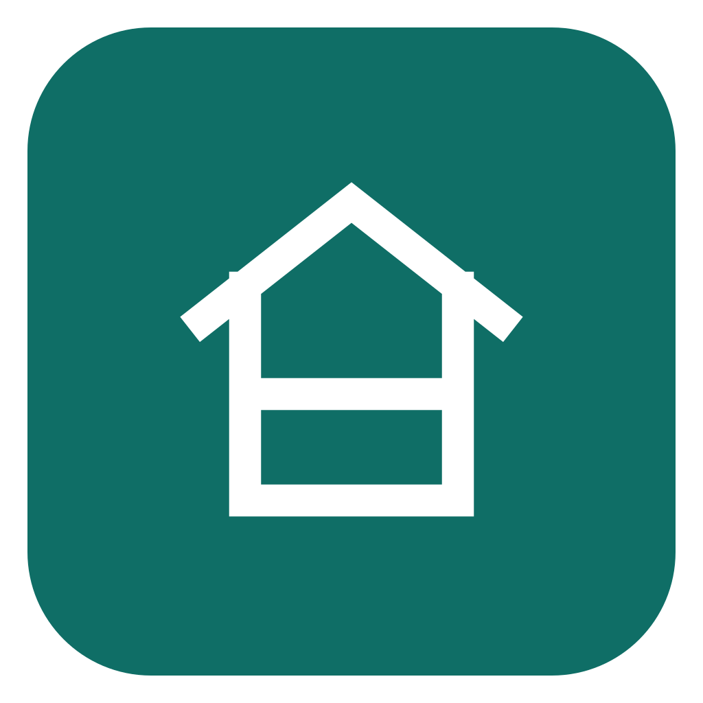
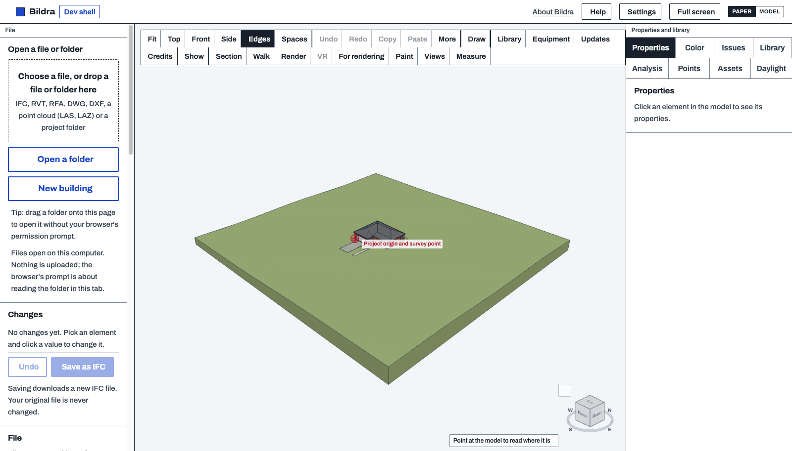

# Bildra

One model. Every plan, section and schedule.



<sub>Paper space above; [the same in model space](screenshots/model.png).</sub>

Bildra is a BIM authoring app: parametric walls, doors and windows on levels and grids, with views, schedules, sheets
and clash checks from one model. It runs in the browser; your files stay on your computer.

Bildra is based on [BimCraft](https://github.com/getcadcraft/bimcraft) by CadCraft (The Data Design Group, Inc.),
under the Apache License 2.0. It is a separate project, not made or endorsed by them.

## Work on it

```sh
node devshell/serve.mjs     # Node 20.19 or newer, no packages; then open http://127.0.0.1:8000/
npm test                    # the app's tests; libraries are fetched by exact version
```

`app/` is the code in development (the same code on every platform; each release is a tag), `web/` `windows/` `linux/` `macos/` `ios/` `android/` hold what ships or builds it on each, `devshell/` runs it without the website (`devshell/README.md`), `tests/` and `fixtures/` are its tests and public sample files. How to contribute: [CONTRIBUTING.md](CONTRIBUTING.md); building from source: [BUILDING.md](BUILDING.md).

## License

Apache License 2.0 ([LICENSE](LICENSE), [NOTICE](NOTICE)). Libraries and their licenses: [THIRD_PARTY.md](THIRD_PARTY.md). Where the code comes from: [PROVENANCE.md](PROVENANCE.md). The names are trademarks; a fork must rename: [TRADEMARKS.md](TRADEMARKS.md).
